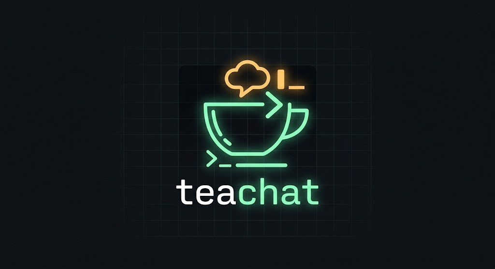

<p align="center">
  
</p>

<p align="center">
  A minimalist terminal chat for developers and sysadmins.
</p>

---

teachat is a chat that lives in your terminal. You join a room, type, press Enter, and everyone in the room sees it. There's no heavy desktop app and no noise: it's a small server and a small client, used like any other Unix tool.

It's built to be **self-hosted**. A team can run its own teachat server on an internal machine, so messages never leave the company network.

## Status

**Early development.** teachat already works for chatting between machines, but it's still taking shape. Expect breaking changes.

What works today:

- Rooms: joining a room that doesn't exist creates it, and a room disappears when its last member leaves. The default room, `local`, is the exception: it exists as long as the server runs.
- Aliases: your name appears in front of every message you send.
- Command-line flags for server, room and alias.
- A full-screen terminal UI: messages on top, an input box at the bottom that grows as you type. Incoming messages never overwrite what you're typing.
- Each alias gets its own color, the same on every client. Your own messages show your alias in bold.
- Pipe mode: `some-command | teachat --room ops` sends each line to the room, still prints it to your terminal, and exits when the input ends.
- Server and client as separate binaries.

What's coming next:

- Configurable server port
- Password-protected rooms and TLS (`wss://`)
- Message history

> ⚠️ **No encryption yet.** Traffic is plain `ws://`, so only use teachat on networks you trust until TLS lands.

## Quick start

Requires Go 1.27 or newer.

```bash
git clone https://github.com/daniel-cmdline/teachat.git
cd teachat

# start the server (listens on port 7347)
go run ./cmd/server

# in another terminal: no flags needed, you land in the "local" room
go run ./cmd/client

# help
go run ./cmd/client -h
```

Run a second client in the same room and start typing.

| Key | Action |
|---|---|
| `Enter` | Send the message |
| `PgUp` / `PgDn` | Scroll through messages |
| `Ctrl+C` | Leave |

Typing anything jumps back to the newest messages.

When stdin isn't a terminal, the client skips the screen and runs in pipe mode instead:

```bash
make 2>&1 | go run ./cmd/client --room ops     # each line goes to the room
tail -f /var/log/app.log | go run ./cmd/client --room ops   # streams until you stop it
```

You still see every line in your terminal. Empty lines are shown but not sent. Pipe mode never opens the chat screen, so it's safe in scripts and cron.

To connect from another machine, point the client at the server and make sure port `7347` is open in the server's firewall:

```bash
go run ./cmd/client --server 192.168.0.10:7347
```

## Client flags

| Flag | Default | Description |
|---|---|---|
| `--server` | `localhost:7347` | Address of the teachat server |
| `--room` | `local` | Room to join. `local` is created when the server starts and always exists, so everyone who skips `--room` meets there |
| `--alias` | your login (`$USER`) | Name shown in front of your messages. Falls back to `anonimo` when `$USER` is unset |

## Project layout

```
cmd/server/   the server: rooms and message relay
cmd/client/   the terminal client
internal/ui/  the client's screen (built on tview)
docs/         project site and documentation
```

Documentation lives in [docs/](docs/): `index.html` is the project site and `docs.html` is the full documentation (usage, client and server reference, protocol, internals). Both are in Portuguese.

Run the tests with `go test ./...`.

The roadmap and the feature log are in [roadmap.md](roadmap.md) and [features.md](features.md). Both are written in Portuguese for now.
